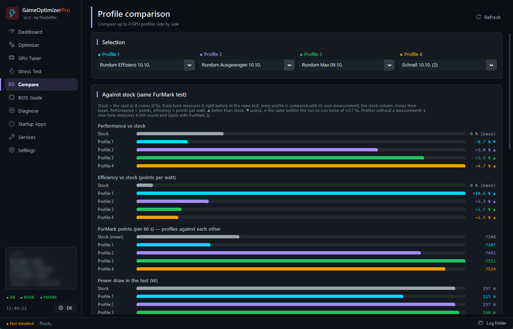
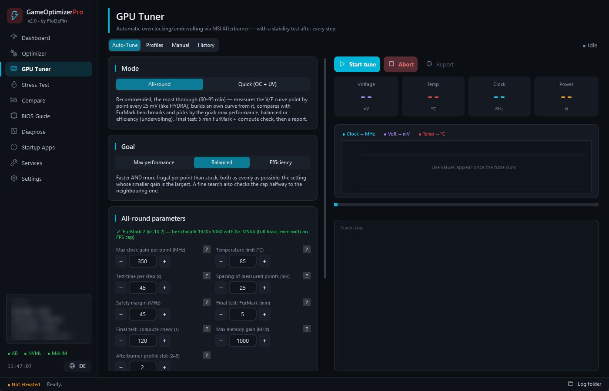
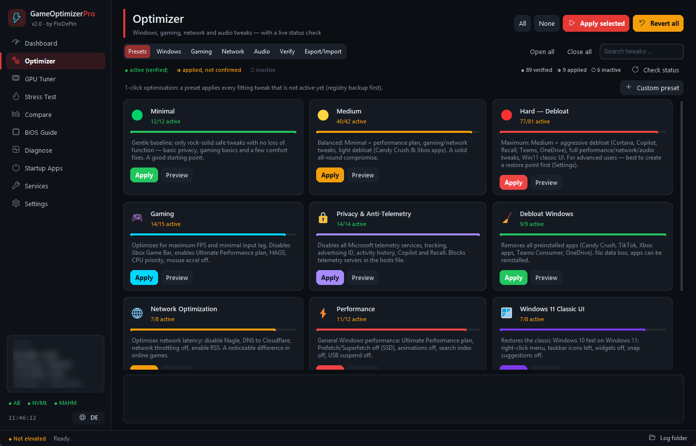

# ⚡ GameOptimizerPro v2.1

**Windows-Gaming-Optimierer mit einem GPU-Auto-Tuner, der die V/F-Kurve deiner Grafikkarte Punkt für Punkt vermisst — dazu 109 umkehrbare Windows-Tweaks, Spiel-Profile, ein BIOS-Guide und Stresstests.**

🇬🇧 [English](README.md) | 🇩🇪 **Deutsch**

Die Bilder zeigen die englische Oberfläche (Standardsprache); auf Deutsch umschalten per `EN/DE` in der Seitenleiste.

## Was die App macht

| | |
|---|---|
| 🎮 **GPU-Auto-Tuner** | Misst jeden Spannungspunkt einzeln und baut eine eigene V/F-Kurve — Ziele *Max. Leistung*, *Ausgewogen*, *Effizienz*. Dazu ein Schnell-Modus (Offset + Power-Limit). |
| ✅ **Geprüft, nicht geraten** | Jeder Schritt läuft mit dem Video-Encoder daneben (wie beim Aufnehmen oder Streamen); gespeichert wird nur, was FurMark, eine Rechenprüfung, einen Spiel-Endtest mit Lastwechseln und einen Härtetest (3D + Video-Encoder + Rechnen gleichzeitig) bestanden hat. Ein Wächter zeichnet Takt und Spannung auf, solange die App läuft, erkennt einen GPU-Hänger im Spiel binnen Sekunden und entschärft nur die betroffenen Kurvenpunkte — der nächste Tune hält dort mehr Abstand. |
| 📊 **Profilvergleich** | Jedes Profil gegen Standard im selben Benchmark: Punkte, Watt, Punkte pro Watt — und die V/F-Kurven im Diagramm. |
| 🛠 **109 Windows-Tweaks** | Mit Live-Prüfung (● aktiv · ◑ angewendet · ○ inaktiv), Presets von *Minimal* bis *Hard*, Registry-Backup vor jeder Änderung, *Alles zurücksetzen*. |
| 🎯 **Spiel-Profile** | Pro Spiel-`.exe`: höhere CPU- und Datenträger-Priorität, auf Wunsch ohne Vollbildoptimierungen — Windows setzt das bei jedem Start selbst, ohne Hintergrundprozess. Läuft das Spiel, zeigt der Status, welche Priorität es wirklich bekommen hat. |
| 🖥 **BIOS-Guide** | 16 Plattformen (ab Intel 8. Gen / Ryzen 1000) mit Menüpfaden für ASUS, MSI, Gigabyte und ASRock; Live-Status nur dort, wo Windows ihn wirklich kennt. |
| 🩺 **Stresstest & Diagnose** | Ein Härtetest wie Spielen mit Aufnahme / Stream (3D, NVENC-Encoder, Rechnen und Speicher gleichzeitig), interner Stresstest, FurMark 1/2 und 3DMark mit Aufzeichnung, Gesundheitsbericht der letzten 30 Tage, Interrupt-Ansicht (MSI oder Leitungs-Interrupt je Gerät), Dienste- und Autostart-Manager, Bereinigung, Dashboard. |

 

## Installation in 5 Schritten

1. **Python 3.10+** von [python.org](https://python.org/downloads) installieren und dabei **„Add Python to PATH“** anhaken.
2. Oben **Code → Download ZIP** klicken und in einen eigenen Ordner entpacken, z. B. `C:\Tools\GameOptimizerPro`.
3. **`install.bat`** doppelklicken und bei der GPU-Last-Frage **J** wählen (`cupy`, ca. 1–2 GB, kein CUDA-Toolkit nötig).
4. Für den GPU-Tuner: [MSI Afterburner](https://www.msi.com/Landing/afterburner/graphics-cards) installieren und einrichten (unten). Empfohlen: [FurMark 2](https://geeks3d.com/furmark/) in einen Ordner `FurMark_win64` neben der App legen — der Tuner vergleicht mit dessen Benchmark.
5. **`GameOptimizerPro.bat`** starten und die Windows-Abfrage bestätigen. Danach aktualisiert sich die App selbst (*Einstellungen → Nach Updates suchen*).

<b>MSI Afterburner einrichten</b> (einmalig, ca. 2 Minuten)

1. Afterburner → Einstellungen → **Allgemein**: **„Spannungssteuerung freischalten“** und **„Spannungsüberwachung freischalten“** anhaken (empfohlen: **„Mit Windows starten“**, **„Minimiert starten“**)
2. Einstellungen → **Überwachung**: die Graphen **GPU-Spannung** und **Leistung** aktivieren
3. Ohne etwas zu ändern auf **Speichern** und dann auf **Platz 1** klicken — das legt die Profildatei der Karte an, und Platz 1 behält deine Werkseinstellungen. GameOptimizerPro schreibt in die Plätze 2–5.
4. Afterburner im Tray laufen lassen. *Einstellungen → Afterburner-Einrichtung* in der App prüft alles.

## GPU-Tuner: welcher Modus?

| Modus | Dauer | Wofür |
|---|---|---|
| **Rundum · Ausgewogen** | 70–105 min | Leistung **und** Effizienz über Standard — die Empfehlung |
| **Rundum · Max. Leistung** | 70–105 min | die höchste Punktzahl |
| **Rundum · Effizienz** | 70–105 min | Standard-Leistung (≥ 99 %) bei möglichst wenig Watt — kühler, leiser |
| **Schnell (OC + UV)** | 40–70 min | ein Takt-Offset und ein Power-Limit, ohne eigene Kurve |

**Was das auf einer Testkarte brachte** (FurMark 2, je 60 s; Standard = Mittelwert aus zehn Standard-Läufen):

| Profil | Punkte | Watt | Leistung | Effizienz |
|---|---:|---:|---:|---:|
| Standard (Ø) | 7278 | 256 | — | — |
| Rundum · Effizienz | 7207 | 215 | ▼ −1,0 % | ▲ +17,9 % |
| Rundum · Ausgewogen | 7491 | 257 | ▲ +2,9 % | ▲ +2,5 % |
| Rundum · Max. Leistung | 7551 | 260 | ▲ +3,7 % | ▲ +2,1 % |
| Schnell (OC + UV) | 7524 | 265 | ▲ +3,4 % | ≈ −0,2 % |

Jede Karte ist anders — deine Werte zeigt der Profilvergleich in der App.

## Sicherheit

- Keine BIOS- oder Treiberänderungen — die GPU läuft über MSI Afterburner und NVML; der BIOS-Guide zeigt nur, was einzustellen ist.
- Jeder Tweak lässt sich einzeln oder komplett zurücksetzen; vor jeder Änderung ein Registry-Backup, vor jeder App-Entfernung ein Wiederherstellungspunkt (sonst ein Klick).
- *Abbrechen* setzt die GPU sofort auf Standard; der GPU-Wächter meldet Abstürze im Spiel (auch einen, der den PC neu startet) und entschärft das Profil dort, wo es gehakt hat.
- Der eigene Zustand der App (Einstellungen, welche Tweaks sie angewendet hat) wird absturzsicher mit letzter guter Kopie gespeichert; ihre Stresslasten enden mit der App, egal wie sie endet; unerwartete Fehler landen in `logs/app_errors.log`.

## FAQ

Muss die App die ganze Zeit laufen?

Nein. Die Tweaks und Spiel-Profile sind Windows-Einstellungen, und das GPU-Profil lädt Afterburner beim Start („Übertaktung beim Systemstart anwenden“).

AMD- oder Intel-Grafik?

Tweaks, BIOS-Guide, Stresstests und Diagnose laufen überall; der GPU-Tuner braucht eine NVIDIA-Karte (Afterburners V/F-Kurve + NVML).

Ärger mit Anti-Cheat?

Die App greift nie in Dateien oder Speicher eines Spiels ein; sie ändert nur Windows- und Afterburner-Einstellungen. Ein Spiel-Profil sagt Windows nur, mit welcher Priorität das Spiel startet — manche Anti-Cheat-Systeme setzen sie zurück, das zeigt der Status in der App.

## Voraussetzungen

Windows 10 / 11 · Python 3.10+ · Admin-Rechte (der Launcher fragt per UAC) · für den GPU-Tuner: eine NVIDIA-Karte, MSI Afterburner und `cupy` (`install.bat` bietet es an); FurMark 2 empfohlen.

## Mehr

- 📖 [Alle Funktionen im Detail](docs/FEATURES.de.md) — samt Projektstruktur
- 📜 [Changelog](CHANGELOG.md) (Englisch)
- 🧪 1539 automatische Prüfungen in 40 Test-Suiten (`python tests\run_all_tests.py`), vor jedem Push
- 🤝 Pull Requests sind willkommen — bei größeren Änderungen bitte zuerst ein Issue öffnen.

MIT-Lizenz · gemacht von FloDePin

