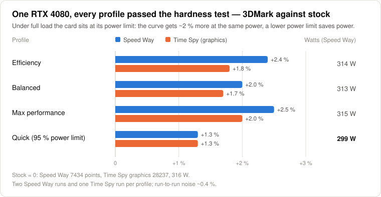
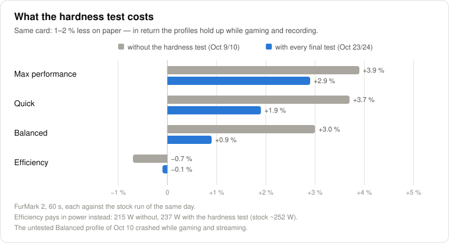

# ⚡ GameOptimizerPro v2.1

**A Windows gaming optimizer with a GPU auto-tuner that measures your card's V/F curve point by point — plus 106 reversible Windows tweaks, game profiles, a BIOS guide and stress tests.**

🇬🇧 **English** | 🇩🇪 [Deutsch](README.de.md)

## What it does

| | |
|---|---|
| 🎮 **GPU auto-tuner** | Measures every voltage point on its own and builds its own V/F curve — goals *Max performance*, *Balanced*, *Efficiency*. Plus a quick mode (offset + power limit). |
| ✅ **Tested, not guessed** | Every step runs with the video encoder next to it (as when recording or streaming); only what passed FurMark, a compute check, a game test with load changes and a hardness test (3D + video encoder + compute at once) is saved. A watchdog records clock and voltage while the app runs, sees an in-game GPU hang within seconds and makes only the curve points involved safer — the next tune keeps extra margin there. |
| 📊 **Profile comparison** | Every profile against stock in the same benchmark: points, watts, points per watt, full load at the power limit — the V/F curves in a chart, and a guided 3DMark comparison on the stress page. |
| 🛠 **106 Windows tweaks** | Live-verified (● active · ◑ applied · ○ inactive), presets from *Minimal* to *Hard*, a registry backup before every change, *Revert all*. |
| 🎯 **Game profiles** | Per game `.exe`: a higher CPU and disk priority, optionally no fullscreen optimizations — Windows applies it at every start, no background process. While the game runs, the status shows the priority it really got. |
| 🖥 **BIOS guide** | 16 platforms (Intel 8th gen / Ryzen 1000 and newer) with menu paths for ASUS, MSI, Gigabyte and ASRock; live status only where Windows really knows it. |
| 🩺 **Stress test & diagnosis** | A hardness test like gaming while recording / streaming (3D, NVENC encoder, compute and memory at once), internal stress test, FurMark 1/2 and 3DMark with recording, a 30-day health report, an interrupt view (MSI or line interrupt per device), services and startup managers, cleaner, dashboard. |

 

## Install in 4 steps

1. Click **Code → Download ZIP** above and extract it to a folder of its own, e.g. `C:\Tools\GameOptimizerPro`.
2. Double-click **`GameOptimizerPro.bat`** and allow the Windows prompt. The first start sets itself up: without Python it offers to install Python 3.12 (asks first), then it downloads the packages the app needs (once, about a minute). From then on the app updates itself (*Settings → Check for updates*).
3. For the GPU tuner's load: double-click **`install.bat`** and answer **Y** (yes) to the GPU load question (`cupy`, about 1–2 GB, no CUDA toolkit needed).
4. For the GPU tuner: install [MSI Afterburner](https://www.msi.com/Landing/afterburner/graphics-cards) and set it up (below). Recommended: put [FurMark 2](https://geeks3d.com/furmark/) into a folder `FurMark_win64` next to the app — the tuner compares with its benchmark.

<b>Setting up MSI Afterburner</b> (once, about 2 minutes)

1. Afterburner → Settings → **General**: tick **"Unlock voltage control"** and **"Unlock voltage monitoring"** (recommended: **"Start with Windows"**, **"Start minimized"**)
2. Settings → **Monitoring**: enable the **GPU voltage** and **Power** graphs
3. Without changing anything click **Save**, then **slot 1** — that creates the card's profile file, and slot 1 keeps your stock settings. GameOptimizerPro writes into slots 2–5.
4. Leave Afterburner running in the tray. *Settings → Afterburner setup* in the app checks all of it.

## GPU tuner: which mode?

| Mode | Time | For |
|---|---|---|
| **All-round · Balanced** | 70–105 min | performance **and** efficiency above stock — the recommendation |
| **All-round · Max performance** | 70–105 min | the highest score |
| **All-round · Efficiency** | 75–110 min | stock performance (≥ 99 %) at the least power, also under full load (a lower power limit) — cooler, quieter |
| **Quick (OC + UV)** | 40–70 min | one clock offset and a power limit, no own curve |

**What it did on a test card** (RTX 4080 — every profile passed all final tests, the hardness test included):

| Profile | 3DMark Speed Way | Time Spy (graphics) | Watts (Speed Way) |
|---|---:|---:|---:|
| Stock | 7434 | 28237 | 316 |
| All-round · Efficiency | ▲ +2.4 % | ▲ +1.8 % | 314 |
| All-round · Balanced | ▲ +2.0 % | ▲ +1.7 % | 313 |
| All-round · Max performance | ▲ +2.5 % | ▲ +2.0 % | 315 |
| Quick (OC + UV, 95 % power limit) | ▲ +1.3 % | ▲ +1.3 % | 299 |

Under full load the card sits at its power limit: the curve gets about 2 % more at the same power, a lower power limit saves power — so *Efficiency* now lowers it too. Stability comes first: the same card without the hardness test looked up to 2 % faster on paper, and one of those profiles crashed while gaming and streaming.

Every card differs — the profile comparison in the app shows yours.

## Safety

- No BIOS or driver changes — the GPU goes through MSI Afterburner and NVML; the BIOS guide only shows what to set.
- Every tweak can be reverted on its own or all at once; a registry backup runs before every change, a restore point before every app removal (and one click otherwise).
- *Abort* puts the GPU back to stock at once; the GPU watchdog reports in-game crashes (also a crash that restarts the PC) and makes the profile safer where it failed.
- The app's own state (settings, which tweaks it applied) is saved crash-safe with a last good copy; its stress loads end with the app, however it ends; unexpected errors are logged to `logs/app_errors.log`.

## FAQ

Does the app have to keep running?

No. The tweaks and game profiles are Windows settings, and Afterburner loads the GPU profile at start-up ("Apply overclocking at system startup").

AMD or Intel graphics?

Tweaks, BIOS guide, stress tests and diagnosis work everywhere; the GPU tuner needs an NVIDIA card (Afterburner's V/F curve + NVML).

Trouble with anti-cheat?

The app never touches a game's files or memory; it changes Windows and Afterburner settings only. A game profile just tells Windows which priority to start the game with — some anti-cheat systems reset it, and the status in the app shows that.

## Requirements

Windows 10 / 11 · Python 3.10+ (the launcher offers to install 3.12) · admin rights (the launcher asks through UAC) · for the GPU tuner: an NVIDIA card, MSI Afterburner and `cupy` (`install.bat` offers it); FurMark 2 recommended.

## More

- 📖 [All features in detail](docs/FEATURES.md) — including the project structure
- 📜 [Changelog](CHANGELOG.md)
- 🧪 1677 automated checks in 46 test suites (`python tests\run_all_tests.py`), run before every push
- 🤝 Pull requests are welcome — for bigger changes please open an issue first.

MIT License · made by FloDePin

